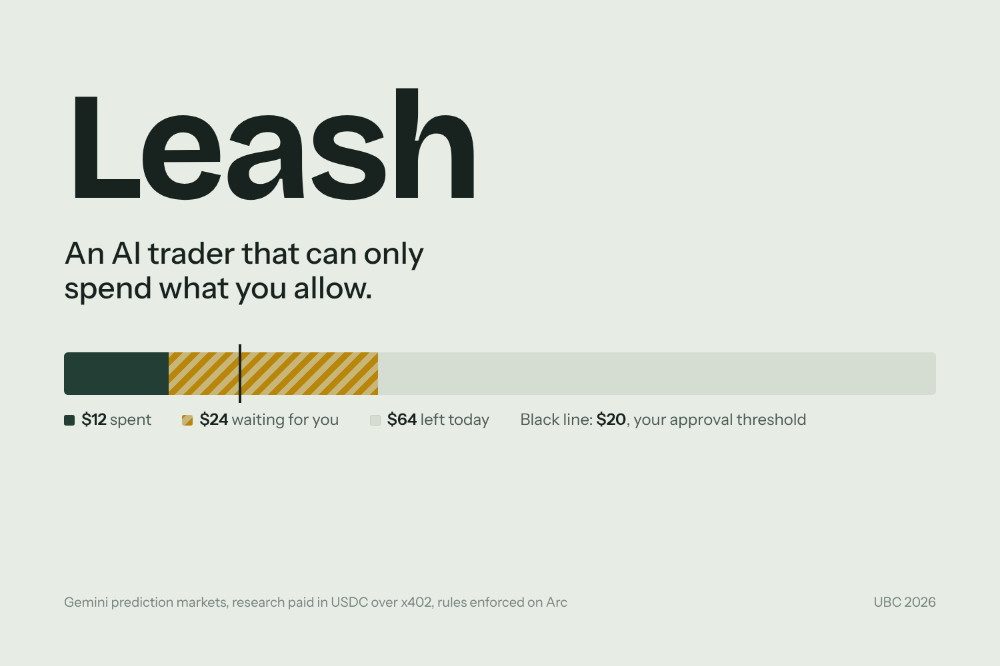

# Leash



See [START.md](START.md) to run it.

An agent that researches X, sells what it learns, and trades on it, all within limits you control.

- **Researches:** Grok Bot reads X on a schedule and submits sentiment reports.
- **Sells:** the reports are sold per request for USDC on Arc via x402. Any agent can buy them.
- **Trades:** our agent buys reports, compares them with Gemini prediction-market odds, and trades when it sees an edge.
- **Within limits:** every spend is checked by a rules contract on Arc. Big trades need a human "yes."

> UBC 2026 Hackathon. Track: Agentic Payments and AI. Chain award: Best use of Arc. Bounties: Gemini Prediction Markets, Grok Bot, QuickNode Streams.

## Status

- [x] `contracts/`: AgentPolicy rules contract + 12 passing tests
- [x] `seller/`: research feed with x402 paywall, Grok Bot ingest, earnings stats + 8 passing tests
- [x] Grok Bot research via browser login (see `seller/GROK_BOT.md`)
- [x] Dashboard: approvals, kill switch, Claude vs market charts
- [x] QuickNode Stream: live contract events, approval alerts (see `seller/quicknode/README.md`)
- [x] `agent/`: decision loop with Claude + 9 passing tests (also tested against a local chain)
- [ ] QuickNode Stream + webhook
- [ ] Dashboard
- [ ] Voice approval (ElevenLabs)

## The rules contract (AgentPolicy)

| Rule | Default |
|---|---|
| Max per request | $50 |
| Max per day (resets at UTC midnight) | $100 |
| Needs human approval at | $20 and up |
| Allowed targets | `gateway` (data budget top-ups) + markets you add |
| Kill switch | `setPaused(true)` stops everything |

**Two kinds of spend**

- **TOPUP**: the agent asks for USDC to refill its x402 data budget. On approval, the contract sends real USDC to the agent.
- **TRADE**: the agent asks permission to place a Gemini order. Gemini trades happen on Gemini's exchange, not onchain, so no USDC moves here. The trading service refuses to place any order that isn't `Approved` in this contract, and records the Gemini order id afterward with `recordExecution`. Every decision leaves a public audit trail.

**Events** (QuickNode Streams listens to these): `SpendRequested`, `ApprovalRequired`, `SpendApproved`, `SpendRejected`, `SpendExecuted`.

## Setup (Mac)

Need Node.js 22+ (`brew install node` or https://nodejs.org).

```bash
cd contracts
npm install
npx hardhat test                    # should show 12 passing
node scripts/generate-wallets.js    # creates owner + agent wallets in contracts/.env
```

Get testnet USDC for **both** printed addresses at https://faucet.circle.com (choose Arc Testnet), then:

```bash
npx hardhat run scripts/deploy.js --network arcTestnet
```

Copy the `POLICY_ADDRESS=...` line it prints into `contracts/.env`.

## The research feed (`seller/`)

| Route | Price | What it is |
|---|---|---|
| `GET /catalog` | free | Topics and prices, so agents can discover what's for sale |
| `GET /stats` | free | Earnings: total USDC, sales, buyers |
| `GET /api/reports/{topic}/latest` | $0.01 | Newest report on a topic |
| `GET /api/reports/{topic}/history` | $0.05 | Last 10 reports |
| `POST /ingest/report` | key required | Grok Bot submits a report (JSON) |
| `GET/POST /submit` | key required | Same, as a web form |

Paid routes use x402. A request without payment gets `402 Payment Required` with the price. The buyer signs a USDC authorization offchain, with no gas, and retries. Circle Gateway verifies it and batches settlement onto Arc. Topics with no reports return a free 404, so nobody pays for nothing.

```bash
cd seller
npm install
npm test                 # 8 passing
npm run setup            # creates seller wallet + ingest key in seller/.env
npm start                # server on http://localhost:4021
npm run test-report      # (2nd terminal) submits a fake report
npm run buy -- fed-jan-cut   # buys it with a real x402 payment from the agent wallet
```

`npm run buy` needs the agent wallet funded with testnet USDC (see contract setup). It deposits $0.50 into Circle Gateway the first time.

## The agent (`agent/`)

### Decision loop
Every `LOOP_MINUTES`, for each market on the watchlist:

1. **Read odds** from Gemini's public API (live prices, even in paper mode).
2. **Buy research** from the feed with x402 ($0.01). It first does a free check and never pays for an empty topic.
3. **Ask Claude** for a probability estimate and confidence. Claude only *estimates*. It has no keys and can't move money.
4. **Do the math** (`strategy.ts`): expected profit per contract after Gemini fees. Skip unless it's at least `MIN_EDGE` and Claude's confidence is at least `MIN_CONFIDENCE`. Size grows with edge and confidence, capped at `MAX_STAKE_USD`.
5. **Ask the contract.** A free dry run first, then `requestSpend`. Small trades are approved instantly. Trades at or above the threshold wait for the owner.
6. **Trade** on Gemini (paper / sandbox / live), then record the order id onchain with `recordExecution`.

Every cycle is logged to `agent/data/decisions.jsonl`.

### Safety limits
| Layer | Limit |
|---|---|
| Claude | Gives a number only. Never decides size, never holds keys. Output is schema-checked. |
| Strategy code | Minimum edge after fees, minimum confidence, max stake per trade |
| Rules contract (onchain) | Per-request cap, daily cap, allowlisted markets only, human approval above threshold, kill switch |
| Data budget | x402 spending comes from a Gateway balance that can only be refilled through a contract `TOPUP` request |
| Keys | The agent key can only *ask*. Only the owner key can approve, change limits, pause, or withdraw. |

### Setup
```bash
cd agent
npm install
npm test                       # 9 passing
cp .env.example .env           # then add ANTHROPIC_API_KEY
npm run markets -- economics   # pick 1-3 markets
```
Put your picks in `agent/.env` as `WATCHLIST=SYMBOL=topic`, then allow each market in the contract:
```bash
cd ../contracts
MARKET=THE-SYMBOL npx hardhat run scripts/allow-market.js --network arcTestnet
```
Run it (with the feed server running in another terminal):
```bash
cd ../agent
npm run once        # one cycle
npm start           # keeps running
npm run pending     # (owner) see trades waiting for approval
npm run approve -- 3
```

## QuickNode Stream (`seller/quicknode/`)

| | |
|---|---|
| **Network** | Arc testnet |
| **Dataset** | Block with Receipts |
| **Filter** | [`filter.js`](seller/quicknode/filter.js): keeps only logs emitted by AgentPolicy whose `topics[0]` matches one of its 7 events (SpendRequested, ApprovalRequired, SpendApproved, SpendRejected, SpendExecuted, Paused, LimitsChanged). Returns `null` for blocks with none, so nothing is delivered. |
| **Destination** | Webhook → `POST /webhooks/quicknode` on the feed server (through the tunnel) |
| **Security** | Every delivery's `X-QN-Signature` (HMAC-SHA256 of nonce + timestamp + body, keyed with the Stream's security token) is verified; forged deliveries get a 401 |

**Why:** the agent's most important moment, a trade that needs a human, happens onchain. The Stream turns that `ApprovalRequired` event into a Mac notification within seconds, and every other contract event into the dashboard's live "Live from Arc" feed, with no polling. Events are de-duplicated by `txHash:logIndex` because Streams may redeliver. Setup steps: [`seller/quicknode/README.md`](seller/quicknode/README.md). Tests run real Arc-shaped receipts through the actual filter and a signed webhook (`seller/test/quicknode.test.ts`).

## Dashboard

```bash
cd agent
npm run dashboard        # http://localhost:4030
```

- **Find a market:** search Gemini's live prediction markets by category and keyword, sorted by tightest spread. **Ask Claude** runs a one-off analysis (optionally buying the latest research report with x402 first) and shows Claude's estimate against the market, the expected profit after fees, and what it would do. Nothing is traded. **Watch** adds the market to the agent's loop and allows it in the contract (an owner-signed `setTarget` transaction); **Stop** removes and blocks it again.
- **Waiting for approval:** trades over the threshold, with **Approve / Reject** buttons (signed with the owner key, recorded onchain)
- **Kill switch:** **Pause agent** makes the contract refuse every new spend
- **Tiles:** budget left today, USDC held by the contract, research bought (x402 spend), research sold (feed earnings), decision counts
- **Claude vs market:** for each market, the market-implied probability and Claude's estimate over time
- **Decisions:** every cycle with Claude's reasoning, expected profit after fees, and explorer links
- **Onchain requests:** everything the agent asked the contract for, with status

The dashboard listens on `127.0.0.1` only and never goes through the tunnel, since it holds the owner key. Every button needs a random token embedded in the page, so other websites can't trigger actions.

## Deployed contracts (Arc testnet)

| Contract | Address |
|---|---|
| AgentPolicy | [`0x18731C3e4dDe85e8D8fC14c67DFFe20e2e69B737`](https://testnet.arcscan.app/address/0x18731C3e4dDe85e8D8fC14c67DFFe20e2e69B737) |
| USDC (ERC-20 interface) | `0x3600000000000000000000000000000000000000` |
